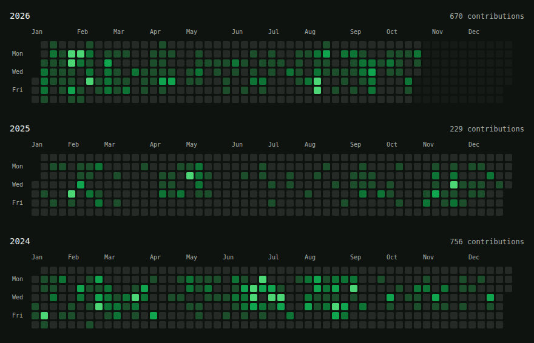

I like to build software and small tools that make everyday tasks a little easier.

  
  
  
  
  
  
  
  
  

I worked with clients across industries at DGTraffic. I also freelance sometimes.

I’m active on my work profile, [@hungryfool-klg](https://github.com/hungryfool-klg), where I work on SSO, authorization, promotions, and services that support daily operations.

